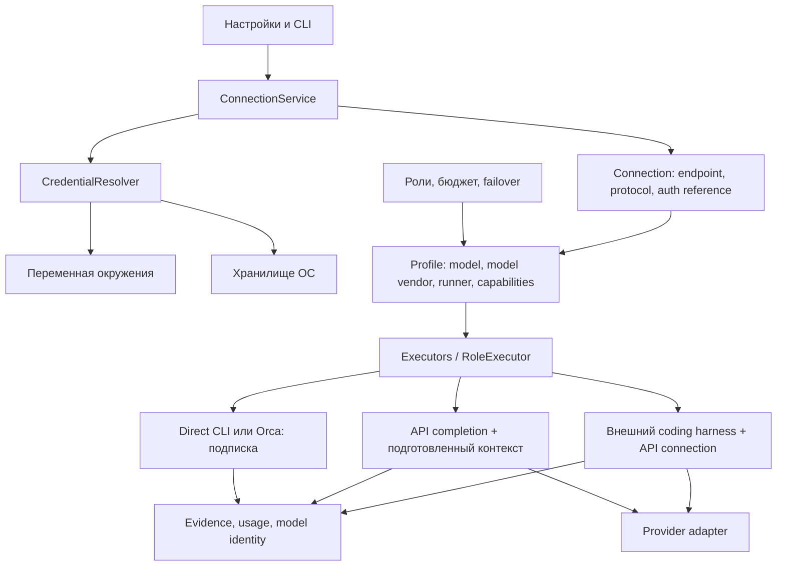

# API-подключения и авторизация моделей в Warden

Актуальный план оставшихся работ: [подключения, надёжность API и маршрутизация Jev](PLAN-MODEL-CONNECTIONS-AND-ROUTING-2026-10-28.md). Ниже сохранены исходное исследование и последовательные обновления; исторические ограничения не следует считать текущим статусом без сверки с новым планом.

Статус: исследование и поэтапная реализация, 2026-10-26. Исходная архитектура изучена на `7d7b4f4`; предложения ниже описывают полный целевой объём. Сделаны Connections/env references, CLI управления, read-only API transport, native probes и редактор подключений в панели: ссылка на переменную окружения, optimistic revision, запись через тот же сервис, что и CLI. Офлайн-контракт OpenCode разбирает `runner: direct` и `harness: opencode`, но не делает профиль допустимым implementer и не подтверждает GonkaRouter. На Windows ссылка `os-store:warden/<id>` читает и записывает Credential Manager текущего пользователя: env-режим работает без vault, недоступное хранилище не заменяется файлом или другим ключом, форма ввода ключа есть только после успешного probe. Инструкция по уже доступным возможностям — [API-CONNECTIONS.md](API-CONNECTIONS.md). Команда `connections auth-login` выполняет OpenRouter PKCE S256 и пишет выданный ключ только в уже выбранный `os-store:warden/<id>`; файл подключения и policy не меняются. Обмен кода проверен локальной заглушкой, живой браузерный login не выполнялся. Обновляемый каталог, сравнение стоимости, другие harness, пересылка ключа в Orca и живой coding smoke остаются планом. Редактор не переносит CLI login и не включает профиль в policy. Авторизованные внешние запросы и coding smoke не выполнялись.

Обновление 2026-10-27: добавлен отдельный preset JoinGonka Gateway и явная команда `connections coding-check` для платного ограниченного теста OpenCode 1.19.4 на одноразовом примере. Сервисный ключ остаётся в Warden; локальный посредник проверяет serving model до передачи ответа агенту. Живые результаты хранятся в квитанциях тестового проекта Orca. Эта команда не снимает запрет общего offline OpenCode adapter, не включает роль в policy и не доказывает строгий денежный лимит. Следующая часть этапа 4 — перенести проверенный путь исполнения в общий adapter и связать допуск с capability receipt, fingerprint и версией бинарника. Описание реализованной команды и её границ — в `API-CONNECTIONS.md`.

Обновление 2026-10-28: проверенный путь включён в общий executor для implementer-профилей с явным `harness_executable`. Допуск требует native-проверки через тот же runtime и квитанции, связанной с fingerprint профиля, подключением, ресурсами и SHA-256 бинарника; ручной даты недостаточно. Отдельный сокращённый deadline задачи сохраняет исходную identity профиля. Обработаны ошибки адаптера без автоматического платного failover, порядок permission rules OpenCode, блокировка незавершённого локального тела и отражение ключа в metadata. Профили других ролей без отдельного доказательства остаются недопустимыми; strict money cap и глобальная маршрутизация API-резерва не включаются автоматически.

## 1. Рекомендуемое решение

Управление подключениями встроить в настройки Warden. Подключение к конкретному API и запуск агента оформить отдельными адаптерами внутри существующей архитектуры. Самостоятельный сервис авторизации/LLM gateway для первого выпуска не нужен.

Пользователь добавляет **свои** ключи OpenRouter/GonkaRouter. Warden хранит ссылку на секрет, выбирает профиль, применяет ограничения и получает квитанцию исполнения. Один ключ обслуживает несколько модельных профилей. Общие продуктовые ключи потребовали бы отдельного backend, биллинга пользователей и контроля злоупотреблений; это другой продуктовый объём.

CLI-подписки остаются отдельным способом оплаты и авторизации. API дополняет их по выбранным ролям, задачам и правилам переключения. Подключить ключ и направить на него coding-задачу — разные операции: HTTP inference сам по себе не умеет читать репозиторий, менять файлы и запускать команды.

| Вариант | Оценка для Warden |
|---|---|
| Ключи и специальные ветки OpenRouter/GonkaRouter прямо в TaskLoop | Смешивает policy, секреты и протоколы; каждый новый сервис затрагивает контроллер |
| Connections в продукте + provider/harness adapters | Рекомендовано: единые настройки и бюджет, изолированные особенности сервисов |
| Отдельный постоянно работающий gateway | Имеет смысл для общей инфраструктуры команды, серверного vault или нескольких приложений; сейчас добавляет процесс, второй журнал и новые отказы |

## 2. Что уже существует

Ссылки в этой таблице относятся к исследованному исходному коду, а не к старым заявлениям о работоспособности интеграций.

| Область | Факт | Источник |
|---|---|---|
| User settings | Профили и policy принадлежат пользователю, каталог `~/.warden`, override `WARDEN_CONFIG_HOME` | `src/main/java/dev/warden/config/UserConfig.java:13`, `:40`, `:48` |
| HTTP adapter | `runner: local`, полный `endpoint`, `api_key_env`; удалённый HTTPS URL parser тоже допускает | `config/Profile.java:289`, `execution/Executors.java:25` |
| API auth | Bearer из env читается перед dispatch; отсутствующий ключ приводит к отказу до HTTP-запроса | `execution/LocalHttpExecutor.java:182`, `:211`, `:323` |
| Redaction | Известный HTTP-токен удаляется из сохраняемого ответа и диагностик | `execution/LocalHttpExecutor.java:87`, `:265` |
| Ограничение HTTP | Один текстовый completion, `stream: false`; извлекается только `choices[0].message.content`; tools отсутствуют | `execution/LocalHttpExecutor.java:345`, `:362` |
| Контекст | В prompt попадают goal/schema/context/пути/changed files; полное содержимое проекта автоматически не загружается | `role/RoleRunner.java:1687` |
| Usage | HTTP adapter извлекает input/output tokens, но не цену, serving model, upstream provider и request ID | `execution/LocalHttpExecutor.java:162` |
| HTTP errors | Все non-2xx сводятся к `role_local_http_error` | `execution/LocalHttpExecutor.java:268` |
| Settings UI | GET `/api/config`; редактирования соединений нет; POST предусмотрен для решений | `dashboard/Dashboard.java:69`, `:90`, `:436` |
| Review independence | Сравнивается `profile.vendor()`, без отдельной идентичности разработчика модели | `role/RoleResolver.java:287` |
| Child process | Обычный ProcessBuilder наследует окружение; per-dispatch overrides/removals отсутствуют | `process/ProcessRunner.java:159` |
| Verification | Сохраняются probe command, stdout/stderr; нельзя предлагать shell probe с ключом в аргументах | `config/ProfileVerifier.java:112` |
| Continuation | RoleContract сравнивает vendor/model/runner и workflow routing, но не identity подключения, endpoint и provider routing/privacy | `role/RoleContract.java:40`, `:68` |
| Orca boundary | Нельзя предполагать передачу произвольного API-подключения: текущая накладка запуска передаёт agent/model/effort | `config/RunOverride.java:29` |

Следовательно, полезный transport задел есть, но нынешний `local` нельзя объявлять готовым API coding executor. Даже API-review без tools требует отдельного сборщика достаточного контекста; одних путей к файлам модели недостаточно.

## 3. Что подтверждают сервисы

### OpenRouter

- OpenAI-совместимый base URL `https://openrouter.ai/api/v1`, auth `Authorization: Bearer`. [Authentication](https://openrouter.ai/docs/api_reference/authentication).
- Есть пользовательский OAuth PKCE: приложение получает ключ аккаунта пользователя. Документированы localhost callback на произвольном порту и headless обмен кодом. Это удобное дополнение к ручному ключу, а не prerequisite MVP. [OAuth](https://openrouter.ai/docs/guides/overview/auth/oauth).
- Каталог возвращает IDs, pricing, context и supported parameters. Доступность конкретного маршрута проверяется отдельно. [Models API](https://openrouter.ai/docs/api/api-reference/models/list-all-models-and-their-properties).
- Нужны явные `require_parameters`, фильтры провайдеров, privacy и price constraints. Цена за миллион токенов и денежный лимит задачи — разные ограничения. [Provider selection](https://openrouter.ai/docs/guides/routing/provider-selection).
- Usage содержит стоимость, reasoning/cache tokens; её следует читать из API, а не доверять JSON, который сочинила модель. [Usage accounting](https://openrouter.ai/docs/cookbook/administration/usage-accounting).
- Auth, credit/budget и transient failures различаются; классификация требует status и metadata. [Errors](https://openrouter.ai/docs/api_reference/errors-and-debugging), [Limits](https://openrouter.ai/docs/api_reference/limits).

### GonkaRouter

Официальная [Integration Guide](https://gonkarouter.io/docs) описывает OpenAI `/v1/chat/completions` и Anthropic `/v1/messages` на `https://api.gonkarouter.io`, Bearer/`x-api-key`, streaming/tools и подключение Claude Code. Она документирует подмену модели при устойчивом upstream 429; для закрепления требуется `X-Gonka-No-Fallback: true`. В квитанцию нужны response model, `X-Gonka-Fallback`, `X-Request-Id`. Receipt API возвращает metadata без стоимости.

В guide также указан output cap 4096, включая reasoning, тогда как [каталог](https://gonkarouter.io/models) показывает иные Max Output. [Pricing](https://gonkarouter.io/pricing) описывает динамическую цену и практический prompt limit примерно 200K. Эффективные лимиты следует проверить; переносить рекламируемые возможности модели в verified profile нельзя. В просмотренных материалах не подтверждены OAuth и стабильный публичный models API: оставить ввод Model ID и статический обновляемый список. Интеграция получает статус experimental до live smoke.

### Снимок стоимости и доступности

На 2026-10-26 публичный `GET https://openrouter.ai/api/v1/models` действительно вернул, среди прочих:

| Пример Model ID | Input / 1M | Output / 1M | Что это доказывает |
|---|---:|---:|---|
| `deepseek/deepseek-v4.1-flash-1017` | $0.15 | $0.60 | Запись в каталоге; указаны tools и structured outputs; pricing также содержит временные overrides |
| `z-ai/glm-5.3-flash` | $0.15 | $0.50 | Запись в каталоге; указаны tools и structured outputs |

Это снимок каталога, не измерение качества, фактического биллинга или работоспособности Warden. [Источник: публичный каталог](https://openrouter.ai/api/v1/models).

GonkaRouter публикует `zai-org/GLM-5.3-Flash` и `deepseek-ai/DeepSeek-V4-Flash-0731`; их IDs отличаются от OpenRouter. В момент чтения каталог показывал $0.0045/1M, pricing — $0.0046/1M input/output. Это динамические рекламируемые цены, не подтверждённая стоимость наших запросов. [Каталог](https://gonkarouter.io/models), [Pricing](https://gonkarouter.io/pricing).

В настройках показывать дату цены, источник, effective route и отдельные input/output/cache/reasoning параметры. Оценивать экономию по стоимости **принятой задачи**, числу ремонтов и времени до результата; цена токена не измеряет пользу coding-модели.

## 4. Разделить подключение, модель и среду агента



`ProviderAdapter` нормализует endpoint/protocol, auth, catalog/probe, request options, error taxonomy и usage. Общий OpenAI Chat transport переиспользуется; OpenRouter/GonkaRouter добавляют только свои routing/headers/receipts. `AgentHarnessAdapter` знает запуск конкретного coding CLI, его конфигурацию, terminal events и завершение. Внешний harness сам выполняет HTTP: provider adapter формирует его конфигурацию и нормализует доступные receipts, а не перехватывает его трафик по умолчанию. Оба слоя работают под policy Warden.

Подключение не выбирает роль и не исполняет команды. Профиль не содержит секрета. Policy выбирает допустимый профиль, но не определяет HTTP-заголовки.

### Проектируемые файлы

- `~/.warden/connections/<id>.yaml`: provider, protocol, base URL, auth reference, enabled, сетевые/routing defaults.
- `~/.warden/profiles/<name>.yaml`: connection ref, role, model, model_vendor, runner/harness, capabilities, ограничения.
- `~/.warden/policy.yaml`: порядок профилей, платный fallback, escalation и независимость.
- `~/.warden/verification/`: квитанции проверки без секретов, effective capabilities и fingerprint конфигурации.

Пример будущего connection schema:

```yaml
version: 1
connection: openrouter-personal
provider: openrouter
protocol: openai_chat
base_url: https://openrouter.ai/api/v1
auth:
  type: api_key
  credential_ref: env:OPENROUTER_API_KEY
enabled: true
```

Для desktop `credential_ref` сможет иметь вид `os-store:warden/openrouter-personal`. Это два явных источника; при недоступном OS store приложение не переходит незаметно к plaintext или другому ключу.

Условный фрагмент будущего coding-профиля:

```yaml
connection: openrouter-personal
role: implementer
runner: direct
harness: opencode
model: z-ai/glm-5.3-flash
model_vendor: z-ai
```

Это иллюстрация новых полей, не полный профиль для текущего parser. `runner: api` можно добавить для простого HTTP completion; существующий `runner: local` сохранить как совместимый legacy-путь без внезапного изменения семантики.

### Идентичность модели и независимость

Хранить отдельно: connection ID, router, фактический inference provider (если известен), model ID, canonical model identity, **model_vendor** и harness. OpenRouter и GonkaRouter — маршрутизаторы, не разработчики всех доступных через них моделей.

GLM через два шлюза остаётся одним model vendor; DeepSeek и GLM через один шлюз могут удовлетворять текущему критерию разных model vendors. Это операционное правило независимости review, не доказательство статистической независимости моделей.

Для known legacy профилей явно мигрировать `codex -> openai`, `claude -> anthropic` и другие подтверждённые соответствия; неизвестные identities дают `unproven`, а не выдуманную независимость. Предусмотреть явное подтверждение model_vendor mapping с provenance и перепроверкой профиля. Это сохраняет загрузку старого schema/login, но намеренно может остановить independent gate неизвестного legacy vendor до уточнения identity. Продолжения проверять против **всех** писателей кандидата. Исторические raw receipts сохранять; нормализованную identity хранить с версией и provenance.

По умолчанию закреплять конкретную модель: без router auto-model/скрытых model fallbacks. Для GonkaRouter отправлять no-fallback header. Переключение inference provider для той же модели и переключение на другую модель — разные события. Если другая модель фактически уже выполнила запись, признать её писателем, инвалидировать прежние чтения и заново проверить assurance до продолжения; нельзя просто отбросить receipt и считать дерево неизменённым. Если serving identity не доказана — `unproven` и остановка соответствующего gate.

## 5. Авторизация и секреты

| Режим | Поведение |
|---|---|
| CLI subscription | Используется собственный login CLI; Warden показывает CLI/account status без извлечения OAuth-токенов |
| API key из env | Сохраняется имя переменной; значение разрешается перед вызовом; режим подходит headless/CI |
| API key в OS store | Ввод в settings, запись в vault под текущим пользователем, хранится только reference |
| OpenRouter login | Позднее PKCE S256; ключ пользователя хранится тем же CredentialStore |
| Local без auth | Только явно выбранное подключение, с ясным статусом «авторизация не требуется» |

Java-проект сохраняет zero-dependencies core. OS vault — отдельный интерфейс и небольшой платформенный helper, например Windows Credential Manager или DPAPI CurrentUser. Чистая Java не получает универсальный desktop vault автоматически. Helper, ACL, упаковка и отказ при недоступности требуют собственной проверки. До этого готовым считается env-режим; форма «сохранить ключ» доступна только при работающем защищённом store.

Обязательные свойства реализации:

1. Ключи не попадают в repository YAML, task, prompt, args, URL, dry-run, exceptions, verification transcript, ledger или browser storage. Для ввода — скрытый terminal input, stdin или write-only POST. GET возвращает лишь состояние и источник; обратного чтения секрета через settings нет.
2. Remote API — HTTPS. HTTP допустим для явно выбранного loopback endpoint. Запретить userinfo/query credentials, привязать secret к origin; redirect не переносит авторизацию другому origin. Смена origin требует нового явного binding.
3. `ProcessRunner` принимает overrides **и removals** на один invocation. Subscription/API профили удаляют конфликтующие auth/endpoint variables по проверенным правилам harness; глобальные env и конфиги пользователя не переписываются. Системные переменные не очищаются без разбора.
4. API harness получает отдельный config/credential scope. Документированный override проверяется на установленной версии CLI: задавать произвольный HOME и считать OAuth отключённым недостаточно. В subprocess не передаются ключи других подключений. Shell tools дочернего агента могут унаследовать выданный ему ключ — это не изоляция секрета от этого агента.
5. Redaction выполняется **до записи байтов** во все persistent outputs. Нынешнее raw capture Direct CLI нельзя считать безопасным для API harness без изменения пути записи. Если нужна строгая изоляция ключа от shell tools, отдельный доверенный proxy без раскрытия upstream secret — следующий архитектурный этап.
6. Disconnect отключает routing, удаление локального ключа отдельно от отзыва на сервисе. Ротация повышает credential revision и обновляет auth-check. Активный dispatch использует свой snapshot; следующие вызовы видят новую revision. Значение ключа и его hash не входят в публичный fingerprint.

## 6. Как выглядят настройки

Существующую таблицу стадий дополнить тремя областями, каждая опирается на один application service для UI и CLI.

**Подключения.** «Добавить» → CLI-подписка / OpenRouter / GonkaRouter / совместимый API. Название, endpoint с preset, источник авторизации, скрытый ключ или имя env, статус, время проверки. Действия: проверить авторизацию, заменить ключ, отключить, удалить. Для custom endpoint показывать адрес назначения до передачи секрета. Существующие references блокируют физическое удаление connection либо требуют явного отключения зависимых профилей.

**Профили моделей.** Connection + точный Model ID; поиск по каталогу, где он поддерживается, и ручной ввод. Роль, среда агента, output/context/time limits, доступные инструменты, фактическая стоимость и capability status. Vision доступен только после собственного pixel probe. Объяснять, почему профиль пока недопустим для implementer/reviewer.

**Маршрутизация.** По каждой роли — основной профиль и резервные. Явные режимы «подписки», «подписки + разрешённый API-резерв», «API-профили для выбранных ролей». Дополнительно лимит денег на run/сутки, output/turn limits и поведение при исчерпании. При выборе резерва показывать источник оплаты, model vendor и влияние на независимость.

Пример строки: `Реализатор: CLI-подписка → резерв GLM / OpenRouter / API / до заданного бюджета`. Обратный маршрут «дешёвая модель → сильная модель после блокирующих findings» использует существующую escalation policy, а не маскируется под network failover.

Состояния проверок раздельны: **секрет задан → auth подтверждена → модель ответила → structured artifact проверен → coding tools проверены**. Баланс, известный модели catalog и простой pong не означают работоспособность coding loop. Изменение model/endpoint/protocol/harness/tools/routing/privacy invalidates соответствующую проверку; ротация ключа требует auth-check, но не выдаёт автоматически новую capability-квитанцию.

Планируемые CLI операции: `connections add/list/check/disable/remove`, `auth set/remove`, `models list`, `profiles verify`. Секрет не принимается открытым positional argument. Native check использует тот же resolver и redaction, что runtime.

Новые Dashboard POST используют loopback, Host/Origin, process token, CSP/no-store и bounded bodies. Settings token должен существовать независимо от режима decision page. Запись — validate + optimistic revision + atomic replace, с сохранением комментариев или явным отказом для незнакомой YAML-формы по принятому дизайну панели. Existing files и актуальные dispatch snapshots не переписываются незаметно.

## 7. Coding loop: практический первый путь

Для первого API implementer рекомендован **существующий внешний multi-provider coding harness**, кандидат — OpenCode. Официально документированы provider/custom provider и headless `run`, включая JSON output. Это основание для spike, не утверждение о совместимости с текущим Warden. [Providers](https://opencode.ai/docs/providers/), [CLI](https://opencode.ai/docs/cli/).

Варианты реализации:

| Вариант | Роль в плане |
|---|---|
| API completion в Warden | Маленький transport; подходит для ограниченной аналитики с подготовленным контекстом; не coding implementer |
| OpenCode adapter | Первый кандидат coding spike: использовать готовые repo/tools/context loop, добавить Warden prompt/artifact/receipt/cancellation contract |
| Claude Code через совместимый Messages endpoint | Альтернативный spike; есть официальные инструкции [OpenRouter](https://openrouter.ai/docs/cookbook/coding-agents/claude-code-integration) и [GonkaRouter](https://gonkarouter.io/docs); нужны изоляция auth, проверка routing всех внутренних вызовов и установленной версии |
| Собственный API-agent | Полный контроль, но нужны tool loop, patch/shell permissions, sandbox, context compaction, MCP, recovery и accounting каждого turn; самостоятельный крупный этап |

При spike проверить prompt delivery через stdin/файл, финальный JSON по Warden schema, read-only enforcement, process/descendant cancellation, реальную serving identity и стоимость внутренних вызовов. JSON event stream или exit 0 без валидного итогового artifact не закрывает роль. Если harness скрывает serving model/cost, показывать unknown и не включать свойства, которые эта интеграция не доказывает.

Orca runner пока остаётся на существующем проверенном launch contract. Поддержку API через Orca добавить только после появления явной передачи connection/secret binding и подтверждённого lifecycle; generic worker-start сам по себе этого не доказывает.

## 8. Бюджет, ошибки и аудит

Сохранять различия между subscription quota, insufficient credits, key/workspace budget и rate limit. HTTP status — вход классификатора, а не вся семантика: budget refusal может прийти как 403, временный in-flight spending refusal — как 402 с metadata/Retry-After.

| Нормализованная причина | Реакция |
|---|---|
| credential missing/invalid | Отказ до отправки либо ошибка auth; показать нужное подключение; не запускать бесконечные retries |
| insufficient credits / provider budget | Остановить расход по подключению; разрешённый резерв — только по policy |
| transient rate limit / in-flight budget | Уважать Retry-After в пределах общего deadline и retry budget |
| model/parameter unsupported | Ошибка профиля, не признак потраченной CLI-подписки |
| network/timeout/mid-stream failure | Учесть потенциально состоявшийся платный вызов; не считать автоматически бесплатным и не повторять бесконтрольно |
| artifact/schema/tool failure | Разделить protocol failure и findings; сохранить нормальный Warden gate |

По умолчанию сохранить текущие failover stop/confirm semantics. Пользователь может заранее разрешить конкретный API-резерв с финансовым пределом; в этом случае отдельного вопроса на каждое переключение не требуется. Сам факт сохранения ключа не включает платный fallback.

Один role dispatch внешнего агента может содержать десятки платных inference turns. Поэтому `max_role_runs` не ограничивает их число/цену. Нужны token/turn/time bounds, provider-side key cap при наличии, учёт уже зарезервированных средств и неразрешённых расходов после сбоя. При параллельных процессах общий суточный лимит и reservations требуют блокировки и crash recovery в user scope.

Строгий денежный cap доступен только там, где adapter умеет доказуемо ограничить затраты; одной декларации `limits.max_cost_usd` недостаточно. Неизвестная стоимость не равна нулю. Для внешнего harness без жёсткого spend control разрешён лишь явно обозначенный advisory limit либо отказ strict mode. Динамическая цена и дополнительные fees также входят в оценку границы.

Receipt: connection ID/revision без секрета, adapter/harness/version, requested/served model, model vendor, upstream provider при наличии, request/generation ID, tokens/cache/reasoning, cost/value/source/currency, duration, finish reason, fallback events, normalized error. Стоимость от модели внутри role JSON не является подтверждённым биллингом.

Continuation fingerprint включает endpoint/protocol, connection identity, model mapping, harness/tool policy, routing/privacy, adapter version. Обновление ключа хранится отдельной revision; изменение backend нельзя скрыть за прежним именем профиля. Исторические artifacts не переписываются.

## 9. Внедрение по проверяемым этапам

Обновление 2026-10-28: единая панель `warden settings` объединяет подключения, CLI/API-профили,
native-проверку допуска, состав ролей и настройки свежего `warden check` перед прогоном. Проверка
ответа не выдаёт coding-допуск и не включает платный fallback. Каталог, подтверждённые денежные
ограничения и Orca forwarding остаются отдельными этапами. Подробности — `MODEL-CHECKS.md`.

1. **Connection core.** UserConfig/Connection/CredentialResolver с env, совместимость `endpoint + api_key_env`, identity migration, connection fingerprint. Ошибки конфигурации и отсутствие секрета видны в doctor/dry-run без сетевого запроса. Сохранить schema/login CLI-подписок; для неизвестного legacy model vendor показать необходимое identity mapping до independent gate.
2. **API transport и native probes.** Общий Chat client, OpenRouter/GonkaRouter adapters, typed errors, output limits, model receipts и cost. Auth/catalog check без inference, где он поддержан; отдельно bounded платная проверка конкретной модели. Context builder для text-role. Fake HTTP доказывает redaction и ограничения до живого вызова.
3. **Настройки авторизации.** ConnectionService, CLI операции и Settings editor; desktop OS store, endpoint binding, optimistic revisions. Env-режим доступен независимо от vault. Сохранённый ключ не включает новый профиль в policy автоматически.
4. **Первый coding adapter.** OpenCode spike на disposable worktree; сначала OpenRouter, затем GonkaRouter с закреплённой моделью. Подтвердить tools/artifact/cancellation/identity/cost; неподтверждённые свойства явно ограничивают eligible roles и strict budgets. После успешного smoke добавить selectable API implementer и резерв к CLI.
5. **Удобство и расширение.** OpenRouter PKCE, обновляемый model catalog, сравнение $/accepted task; затем дополнительные harness/Orca API connection forwarding по потребности. Отдельный gateway рассматривать при появлении командного сервера или необходимости держать ключ вне agent subprocess.

Минимальный законченный вертикальный сценарий: добавить OpenRouter connection → задать env/vault credential → проверить auth и модель → проверить один harness на fixture → назначить его резервом конкретной роли с лимитом → получить ledger с реальным model identity и расходами. Просто форма API key не закрывает сценарий.

## 10. Приёмка реализации

- Existing CLI-профили, текущие local HTTP profiles и project configs продолжают загружаться; миграция не трогает глобальный login. Подтверждённые identities сохраняют routing, неизвестные требуют явного mapping до independent gate.
- Секрет не появляется в GET, disk config, raw/error/verify/dry-run outputs; echo и частичный ответ не обходят redaction. Child process не получает чужие connection secrets.
- HTTP redirect/смена origin не уводит Bearer; пропавший credential не приводит к anonymous downgrade.
- Auth-check не выдаёт coding verification; смена backend/model/harness сбрасывает нужные проверки и continuation eligibility.
- GLM через два router не считается независимым review; другой подтверждённый model vendor через тот же router рассматривается по policy. Unknown/substituted identity не выдаёт ложный independent pass.
- Tests покрывают 401, credit/budget metadata, 429/Retry-After, 5xx, timeout после отправки, SSE error/obрыв, output truncation и unknown cost; retries укладываются в общий deadline/budget.
- End-to-end fixture подтверждает чтение файла, ограниченную правку, запуск gate, валидный artifact и завершение всех дочерних процессов; read-only роль не получает write tools.
- Платный fallback запускается только в разрешённой policy границе; сильная модель после product findings проходит через escalation. Каждый потенциально платный turn учитывается.

Первоначальное исследование ограничивалось source/documentation review и публичным catalog read. Последующая реализация и проверки описаны в статусе выше и `API-CONNECTIONS.md`: OS vault проверен отдельно, живые coding probes имеют собственные квитанции; проверенный implementer допущен в обычную петлю. Сверка фактического биллинга, расширение допуска на другие роли и Orca forwarding остаются незакрытыми; список выше задаёт критерии полной приёмки.
